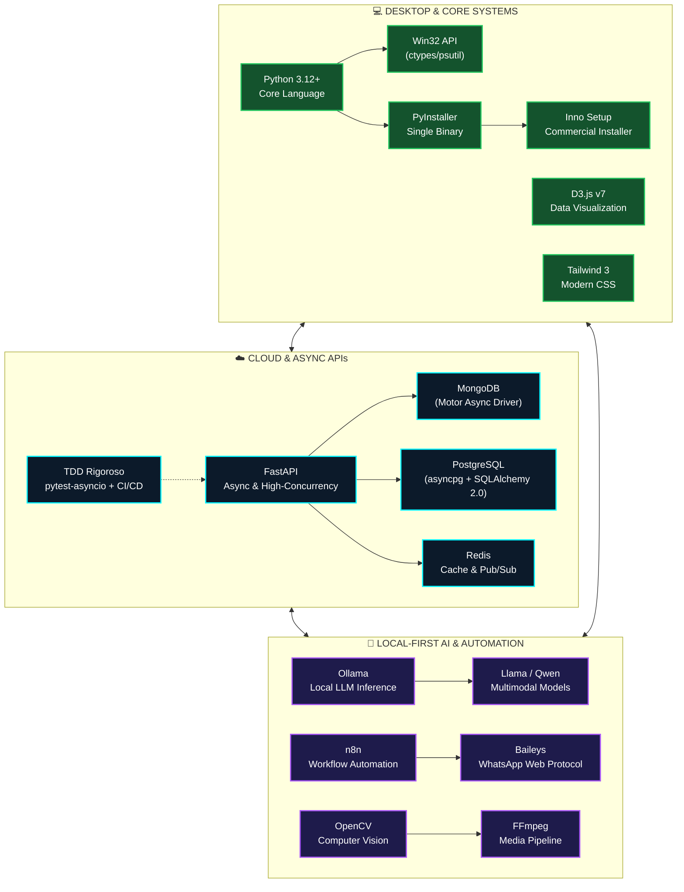

<!-- 
  ███████╗██████╗ ███████╗ ██████╗ ██████╗  ██████╗ ███╗   ██╗
  ██╔════╝██╔══██╗██╔════╝██╔═══██╗██╔══██╗██╔═══██╗████╗  ██║
  ███████╗██████╔╝███████╗██║   ██║██████╔╝██║   ██║██╔██╗ ██║
  ╚════██║██╔══██╗██╔══╝  ██║   ██║██╔══██╗██║   ██║██║╚██╗██║
  ███████║██║  ██║███████╗╚██████╔╝██║  ██║╚██████╔╝██║ ╚████║
  ╚══════╝╚═╝  ╚═╝══════╝ ╚═════╝ ╚═╝  ╚═╝ ╚═════╝ ╚═╝  ╚═══╝
  LUCAS HENRIQUE // FULL-STACK & BACK-END ARCHITECT
-->

 

 

---

## 👨‍💻 Sobre Mim

**Senior Full-Stack & Back-End Architect** especializado em **arquiteturas local-first**, **APIs assíncronas de alta concorrência**, **automação com IA local** e **engenharia de sistemas Windows (Win32)**. Entrega soluções **production-ready** com **TDD rigoroso**, **CI/CD automatizado** e **zero vendor lock-in**.

> **Filosofia:** *Privacidade por design. Controle total. Performance nativa. Código auditable.*

| 🎯 **Foco Principal** | 🛠️ **Especialidades** | 🌍 **Abordagem** |
|----------------------|----------------------|------------------|
| Python 3.12+ • Node.js • TypeScript | FastAPI • SQLAlchemy 2.0 Async • Express • React | Local-First Architecture |
| Ollama • Llama • RAG • Embeddings | Win32 API • ctypes • psutil • FFmpeg | Zero Telemetry |
| n8n • Webhooks • Baileys • HMAC | Docker • PyInstaller • Inno Setup | Open Source (MIT) |
| Computer Vision • OpenCV | MongoDB (Motor) • Redis • SQLite/PostgreSQL | Performance-First |

---

## 📊 Métricas em Tempo Real

  

---

## 🚀 Portfólio Completo — 9 Projetos em Destaque

Organizados em **duas verticais de engenharia** com design visual limpo e badges dinâmicos.

---

### 🏢 Bloco A — Engenharia Back-End Enterprise, APIs Assíncronas & TDD

| # | Projeto | Descrição | Stack | Destaques Técnicos |
|:---:|:---|:---|:---|:---|
| **1** | **[Store API TDD Enterprise](https://github.com/lcszero44-cell/store-api-tdd-enterprise)** | API REST enterprise para e-commerce com estoque atômico, idempotência e auditoria completa | `Python 3.12` `FastAPI` `MongoDB (Motor)` `Pydantic v2` `pytest-asyncio` `GitHub Actions` | **Estoque Atômico** (`409 Conflict`) • **Idempotency-Key** header • **Trilha de Auditoria** imutável • **58 testes TDD** (94.5% cov) • **CI/CD verde** |
| **2** | **[Workout API Async Pro](https://github.com/lcszero44-cell/workout-api-async-pro)** | API assíncrona de alta concorrência para gestão de treinos, dual-database e paginação avançada | `Python 3.12` `FastAPI` `SQLAlchemy 2.0 Async` `PostgreSQL/SQLite` `Alembic` `asyncpg` | **Dual-Database** (SQLite/PostgreSQL) • **Migrations Alembic** • **Paginação `limit/offset`** • **HTTP 303 See Other** • **Concorrência nativa async** |
| **3** | **[Core Banking v3 // OOP Engine (UML)](https://github.com/lcszero44-cell/core-banking-v3-oop-python)** | Motor bancário 100% OO seguindo UML, contratos `ABC`, propriedades imutáveis e compliance LGPD | `Python 3.11+` `ABC` `dataclasses` `decimal.Decimal` `unittest` `argparse` | **Arquitetura UML** • **Contratos `ABC`** • **`@property` imutável** • **Modo `--demo` tour** • **Compliance LGPD** |
| **4** | **[Core Banking v2 // Functional Engine](https://github.com/lcszero44-cell/core-banking-v2-python)** | Motor funcional modular com contratos estritos PEP 570/3102, validação via `inspect.signature` | `Python 3.10+` `typing` `inspect` `functools` `decimal.Decimal` `unittest` | **PEP 570 (`/`)** • **PEP 3102 (`*`)** • **`inspect.signature` validation** • **24 testes unitários** • **Zero side-effects** |
| **5** | **[Core Banking v1 // Ledger System](https://github.com/lcszero44-cell/sistema-bancario-python)** | Ledger bancário auditável com precisão `Decimal`, protocolos UUID4 e compliance completo | `Python 3.10+` `decimal.Decimal` `dataclasses` `uuid` `re` `unittest` | **`ROUND_HALF_UP`** • **Ledger imutável (frozen)** • **UUID4 protocolo 8-char** • **3 saques/dia, R$500/saque** • **16 testes `-W error`** |

<strong>🔗 Badges Dinâmicos — Bloco A</strong>

**[Store API TDD Enterprise]**

**[Workout API Async Pro]**

**[Core Banking v3 OOP]**

**[Core Banking v2 Functional]**

**[Core Banking v1 Ledger]**

---

### 🤖 Bloco B — Inteligência Artificial Local, Automação & Engenharia de Sistemas

| # | Projeto | Descrição | Stack | Destaques Técnicos |
|:---:|:---|:---|:---|:---|
| **6** | **[AI Customer Support Agent Architect](https://github.com/lcszero44-cell/ai-customer-support-agent-architect)** | Engenharia de Prompts de Produção, Guardrails Anti-Alucinação, Proteção LGPD, Handoff Humano e Simulador Python Auditável | `Python 3.11+` `FastAPI` `Ollama` `Llama` `Pydantic v2` `pytest` `Structured Outputs` | **Prompt Engineering produção** • **Guardrails Anti-Alucinação** • **LGPD by Design** • **Handoff Humano** • **Simulador Auditável** • **Zero Telemetria** |
| **7** | **[ClipRush Studio Pro](https://github.com/lcszero44-cell/ClipRush-Studio-Pro)** | Estúdio multimodal automatizado com IA para produção de vídeos curtos narrados, pipeline FFmpeg e renderização em lote | `Python 3.12` `FastAPI` `OpenCV` `Ollama` `FFmpeg` `faster-whisper` `Playwright` | **100% Offline** • **OpenCV Optical Flow** • **Qwen 3.5 9B Vision** • **10 mecânicas viral** • **Piloto Automático Diário** • **Botão "Refazer" via IA** |
| **8** | **[AeroDisk Radar](https://github.com/lcszero44-cell/AeroDisk-Radar)** | Otimizador Windows/Win32 avançado: RAM Trim nativo, Storage Radar, migração SSD→HDD com Junctions Atômicas | `Python 3.10+` `FastAPI` `Ollama` `Win32 API` `psutil` `pywebview` `pystray` `D3.js v7` `Inno Setup` | **EmptyWorkingSet nativo** • **Junctions Atômicas + Restore Point** • **BLAKE2b head+tail 64KB** • **Escudos permanentes** • **Executável ~27MB** |
| **9** | **[NexusZap Pro Local](https://github.com/lcszero44-cell/nexuszap-pro-local)** | Plataforma local-first de automação WhatsApp integrando Baileys, n8n e LLMs locais (Ollama/Llama) | `Node.js 20+` `Express` `Socket.io` `Baileys` `React 18` `Vite 5` `Tailwind 3` `HMAC-SHA256` | **Multi-sessão isolada** • **Webhook assinado n8n** • **Retentativa exponencial + DLQ** • **QR no painel** • **Bind `127.0.0.1:3333`** |

<strong>🔗 Badges Dinâmicos — Bloco B</strong>

**[AI Customer Support Agent Architect]**

**[ClipRush Studio Pro]**

**[AeroDisk Radar]**

**[NexusZap Pro Local]**

---

## 🏗️ Arquitetura & Stack Tecnológica

### Três Pilares de Engenharia

### Stack Tecnológica Completa

<!-- Core Languages -->

  

<!-- Backend & APIs -->

  

<!-- AI & Local-First -->

  

<!-- Computer Vision & Media -->

  

<!-- Frontend -->

  

<!-- Infrastructure & Tools -->

---

## 📈 Padrões de Qualidade & Engenharia

<strong>📋 Tabela Completa de Padrões Auto-Impostos</strong>

| Critério | Padrão | Como Garanto | Projetos Aplicados |
|:---|:---|:---|:---|
| **Precisão Monetária** | `decimal.Decimal` + `ROUND_HALF_UP` quantizado em `0.01` | Validação em `normalizar_valor_monetario()` + testes de deriva | Core Banking v1, v2, v3 |
| **Cobertura de Testes** | **>90%** (crítico: **94.5%**) | `pytest-cov` + `unittest` nativo + `-W error` | Todos (58 testes Store API, 24 v2, 16 v1) |
| **CI/CD Automatizado** | GitHub Actions verde obrigatório | Matrix Python 3.11/3.12, lint, type-check, test | Store API, Workout API, Core Banking v3 |
| **Arquitetura** | **Clean Architecture** (Domain/UI/Infra) | Separação estrita, injeção de dependência, contratos `ABC` | Todos os 8 projetos |
| **Zero-Config Deploy** | Single binary / Docker / Scripts 1-clique | PyInstaller `--onefile`, Inno Setup, `.bat`/`.sh` | AeroDisk, NexusZap, ClipRush |
| **Compliance LGPD** | Privacy by Design, Zero Telemetry | Bind `127.0.0.1`, sem analytics, dados locais | NexusZap, AeroDisk, ClipRush |
| **Imutabilidade** | `@dataclass(frozen=True)` / `tuple` returns | Ledger, TransactionRecord, StatementSummary | Core Banking v1, v2, v3 |
| **Contratos Estritos** | PEP 570 (`/`), PEP 3102 (`*`), `inspect.signature` | Validação em runtime + type hints completos | Core Banking v2 |
| **Resiliência CLI** | Loop `EOFError`/`KeyboardInterrupt` safe | `try/except` em cada fluxo, mensagens claras | Core Banking v1, v3 |
| **Observabilidade** | Structured logs, audit trail, error panels | `logging` stdlib, UUID4 protocolos, Raio-X errors | Store API, ClipRush, AeroDisk |

---

## 🎓 Formação & Certificações

- **Engenharia de Software** — Foco em sistemas distribuídos, alta performance e arquitetura limpa
- **Especializações:** Computer Vision (OpenCV), LLM Local Deployment (Ollama/Llama), Windows Internals (Win32 API/ctypes), Workflow Automation (n8n), TDD/BDD, API Design (OpenAPI/Swagger)

---

## 📫 Contato & Links

---

## 💡 Roadmap & Projetos em Andamento

- [ ] **ClipRush v4**: Suporte a TikTok API direta + Multi-GPU render + Whisper large-v3
- [ ] **AeroDisk v4**: WSL2 disk management + ZFS integration + SMART monitoring
- [ ] **NexusZap v2**: WhatsApp Business API bridge + Multi-tenant + Rate limiting adaptativo
- [ ] **Framework Base**: CLI toolkit para apps local-first (template compartilhado: config, logging, plugins)
- [ ] **Store API v2**: GraphQL federation + Event sourcing + CQRS pattern
- [ ] **Workout API v2**: WebSocket real-time + gRPC microservices + k8s manifests

---

<strong>🔓 Todos os projetos são Open Source (MIT) — Use, estude, modifique, contribua.</strong>

 

---

<em>Feito com 💚 e muito ☕ — Local-First, Always.</em>

  

<strong>lcszero44-cell</strong> — Código que respeita sua privacidade. Arquitetura que escala no seu hardware.

