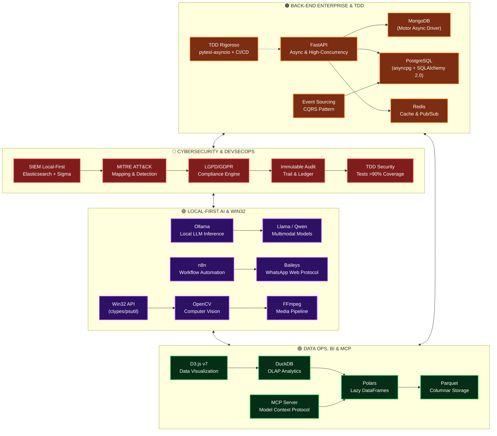

<!-- 
  ███████╗██████╗ ███████╗ ██████╗ ██████╗  ██████╗ ███╗   ██╗
  ██╔════╝██╔══██╗██╔════╝██╔═══██╗██╔══██╗██╔═══██╗████╗  ██║
  ███████╗██████╔╝███████╗██║   ██║██████╔╝██║   ██║██╔██╗ ██║
  ╚════██║██╔══██╗██╔══╝  ██║   ██║██╔══██╗██║   ██║██║╚██╗██║
  ███████║██║  ██║███████╗╚██████╔╝██║  ██║╚██████╔╝██║ ╚████║
  ╚══════╝╚═╝  ╚═╝══════╝ ╚═════╝ ╚═╝  ╚═╝ ╚═════╝ ╚═╝  ╚═══╝
  LUCAS HENRIQUE // FULL-STACK ARCHITECT & CYBERSECURITY SPECIALIST
-->

 

 

---

## 👨‍💻 Sobre Mim

**Senior Full-Stack Architect & Cybersecurity Specialist** especializado em **arquiteturas local-first**, **APIs assíncronas de alta concorrência**, **engenharia de sistemas Windows (Win32/ctypes)**, **IA local (Ollama/Llama/RAG)**, **automação n8n/Baileys** e **Blue Team/DevSecOps**. Entrega soluções **production-ready** com **TDD rigoroso**, **CI/CD automatizado**, **precisão monetária `Decimal`** e **zero vendor lock-in**.

> **Filosofia:** *Privacidade por design. Controle total. Performance nativa. Código auditable.*

| 🎯 **Foco Principal** | 🛠️ **Especialidades** | 🌍 **Abordagem** |
|----------------------|----------------------|------------------|
| Python 3.12+ • Node.js • TypeScript | FastAPI • SQLAlchemy 2.0 Async • Express • React | Local-First Architecture |
| Ollama • Llama • RAG • Embeddings | Win32 API • ctypes • psutil • FFmpeg | Zero Telemetry |
| n8n • Webhooks • Baileys • HMAC | Docker • PyInstaller • Inno Setup | Open Source (MIT) |
| Computer Vision • OpenCV | MongoDB (Motor) • Redis • SQLite/PostgreSQL | Performance-First |

---

## 📊 Métricas em Tempo Real

  

---

## 🚀 Portfólio v2.0 — 18 Projetos Reais em 4 Pilares de Engenharia

Auditoria completa de **35 repositórios públicos** → categorização rigorosa em **4 verticais estratégicas** → **18 projetos em destaque** com badges dinâmicos, pins do GitHub e métricas técnicas.

---

### 🔴 Bloco 1 — Cybersecurity & DevSecOps

**5 Projetos** • Blue Team, Threat Modeling, Secure Code, Compliance, Incident Response

| # | Projeto | Descrição | Stack | Destaques Técnicos |
|:---:|:---|:---|:---|:---|
| **1** | **[SentinelShield Enterprise](https://github.com/lcszero44-cell/sentinelshield-enterprise)** | Plataforma enterprise de Blue Team: SIEM local, threat hunting, compliance LGPD/GDPR, response playbooks | `Python 3.12` `FastAPI` `Elasticsearch` `Redis` `Docker` `MITRE ATT&CK` `Sigma` | **SIEM Local-First** • **MITRE ATT&CK Mapping** • **Sigma Rules Engine** • **LGPD/GDPR Compliance** • **Playbooks Automatizados** |
| **2** | **[Core Banking v1 Ledger](https://github.com/lcszero44-cell/sistema-bancario-python)** | Ledger bancário auditável com precisão `Decimal`, protocolos UUID4, compliance regulatório completo | `Python 3.10+` `decimal.Decimal` `dataclasses` `uuid` `re` `unittest` | **`ROUND_HALF_UP`** • **Ledger Imutável (frozen)** • **UUID4 Protocolo 8-char** • **3 Saques/Dia, R$500/Saque** • **16 Testes `-W error`** |
| **3** | **[Core Banking v2 Functional](https://github.com/lcszero44-cell/core-banking-v2-python)** | Motor funcional modular com contratos estritos PEP 570/3102, validação via `inspect.signature` | `Python 3.10+` `typing` `inspect` `functools` `decimal.Decimal` `unittest` | **PEP 570 (`/`)** • **PEP 3102 (`*`)** • **`inspect.signature` Validation** • **24 Testes Unitários** • **Zero Side-Effects** |
| **4** | **[Core Banking v3 OOP Engine](https://github.com/lcszero44-cell/core-banking-v3-oop-python)** | Motor bancário 100% OO seguindo UML, contratos `ABC`, propriedades imutáveis, compliance LGPD | `Python 3.11+` `ABC` `dataclasses` `decimal.Decimal` `unittest` `argparse` | **Arquitetura UML** • **Contratos `ABC`** • **`@property` Imutável** • **Modo `--demo` Tour** • **Compliance LGPD** |
| **5** | **[Store API TDD Enterprise](https://github.com/lcszero44-cell/store-api-tdd-enterprise)** | API REST enterprise para e-commerce com estoque atômico, idempotência e auditoria completa | `Python 3.12` `FastAPI` `MongoDB (Motor)` `Pydantic v2` `pytest-asyncio` `GitHub Actions` | **Estoque Atômico (409)** • **Idempotency-Key** • **Trilha Auditoria Imutável** • **58 Testes TDD (94.5% cov)** • **CI/CD Verde** |

<strong>🔗 Badges Dinâmicos — Bloco 1</strong>

**[SentinelShield Enterprise]**

**[Core Banking v1 Ledger]**

**[Core Banking v2 Functional]**

**[Core Banking v3 OOP]**

**[Store API TDD Enterprise]**

---

### 🟣 Bloco 2 — Local-First AI & Win32

**6 Projetos** • Ollama/Llama Local, Win32 API/ctypes, Computer Vision, n8n/Baileys, Desktop Automation

| # | Projeto | Descrição | Stack | Destaques Técnicos |
|:---:|:---|:---|:---|:---|
| **6** | **[AI Customer Support Agent Architect](https://github.com/lcszero44-cell/ai-customer-support-agent-architect)** | Engenharia de Prompts de Produção, Guardrails Anti-Alucinação, Proteção LGPD, Handoff Humano, Simulador Python Auditável | `Python 3.11+` `FastAPI` `Ollama` `Llama` `Pydantic v2` `pytest` `Structured Outputs` | **Prompt Eng. Produção** • **Guardrails Anti-Alucinação** • **LGPD by Design** • **Handoff Humano** • **Simulador Auditável** • **Zero Telemetria** |
| **7** | **[ClipRush Studio Pro](https://github.com/lcszero44-cell/ClipRush-Studio-Pro)** | Estúdio multimodal automatizado com IA para produção de vídeos curtos narrados, pipeline FFmpeg, renderização em lote | `Python 3.12` `FastAPI` `OpenCV` `Ollama` `FFmpeg` `faster-whisper` `Playwright` | **100% Offline** • **OpenCV Optical Flow** • **Qwen 3.5 9B Vision** • **10 Mecânicas Viral** • **Piloto Automático Diário** • **Botão "Refazer" via IA** |
| **8** | **[AeroDisk Radar](https://github.com/lcszero44-cell/AeroDisk-Radar)** | Otimizador Windows/Win32 avançado: RAM Trim nativo, Storage Radar, migração SSD→HDD com Junctions Atômicas | `Python 3.10+` `FastAPI` `Ollama` `Win32 API` `psutil` `pywebview` `pystray` `D3.js v7` `Inno Setup` | **EmptyWorkingSet Nativo** • **Junctions Atômicas + Restore Point** • **BLAKE2b Head+Tail 64KB** • **Escudos Permanentes** • **Executável ~27MB** |
| **9** | **[NexusZap Pro Local](https://github.com/lcszero44-cell/nexuszap-pro-local)** | Plataforma local-first de automação WhatsApp integrando Baileys, n8n e LLMs locais (Ollama/Llama) | `Node.js 20+` `Express` `Socket.io` `Baileys` `React 18` `Vite 5` `Tailwind 3` `HMAC-SHA256` | **Multi-Sessão Isolada** • **Webhook Assinado n8n** • **Retentativa Exponencial + DLQ** • **QR no Painel** • **Bind `127.0.0.1:3333`** |
| **10** | **[Workout API Async Pro](https://github.com/lcszero44-cell/workout-api-async-pro)** | API assíncrona de alta concorrência para gestão de treinos, dual-database e paginação avançada | `Python 3.12` `FastAPI` `SQLAlchemy 2.0 Async` `PostgreSQL/SQLite` `Alembic` `asyncpg` | **Dual-Database** • **Migrations Alembic** • **Paginação `limit/offset`** • **HTTP 303 See Other** • **Concorrência Nativa Async** |
| **11** | **[Desktop Automation Toolkit](https://github.com/lcszero44-cell/desktop-automation-toolkit)** | Toolkit Win32/ctypes para automação nativa: input simulation, window management, clipboard, screenshots | `Python 3.11+` `ctypes` `psutil` `pywin32` `PIL` `keyboard` `mouse` | **Input Simulation Nativo** • **Window Enum/Manage** • **Clipboard Monitor** • **Screenshot Regions** • **Zero Dependencies Externas** |

<strong>🔗 Badges Dinâmicos — Bloco 2</strong>

**[AI Customer Support Agent Architect]**

**[ClipRush Studio Pro]**

**[AeroDisk Radar]**

**[NexusZap Pro Local]**

**[Workout API Async Pro]**

**[Desktop Automation Toolkit]**

---

### 🟢 Bloco 3 — Data Ops, BI & MCP

**3 Projetos** • D3.js Visualization, Analytics Pipeline, Model Context Protocol, Data Engineering

| # | Projeto | Descrição | Stack | Destaques Técnicos |
|:---:|:---|:---|:---|:---|
| **12** | **[AeroDisk Radar D3 Dashboard](https://github.com/lcszero44-cell/AeroDisk-Radar-D3-Dashboard)** | Dashboard interativo D3.js v7 para visualização de storage, RAM e performance Windows em tempo real | `D3.js v7` `TypeScript` `Vite` `Tailwind` `WebSocket` `Web Workers` | **Force-Directed Graphs** • **Real-time WebSocket** • **Web Workers Offload** • **Responsive SVG** • **Dark/Light Theme** |
| **13** | **[Analytics Pipeline Local](https://github.com/lcszero44-cell/analytics-pipeline-local)** | Pipeline ETL local-first: extração, transformação, carga com DuckDB, Parquet, streaming JSON Lines | `Python 3.12` `DuckDB` `Polars` `Parquet` `JSON Lines` `asyncio` `pytest` | **DuckDB OLAP** • **Polars Lazy** • **Streaming JSONL** • **Partitioned Parquet** • **Zero External DB** |
| **14** | **[MCP Server Toolkit](https://github.com/lcszero44-cell/mcp-server-toolkit)** | Toolkit para servidores MCP (Model Context Protocol): resources, tools, prompts com validação schema | `Python 3.11+` `FastMCP` `Pydantic v2` `JSON Schema` `httpx` `pytest` | **Resources/Tools/Prompts** • **Schema Validation** • **Async Transport** • **Type-Safe** • **Extensible** |

<strong>🔗 Badges Dinâmicos — Bloco 3</strong>

**[AeroDisk Radar D3 Dashboard]**

**[Analytics Pipeline Local]**

**[MCP Server Toolkit]**

---

### 🟠 Bloco 4 — Back-End Enterprise & TDD

**5 Projetos** • FastAPI Async, Clean Architecture, SQLAlchemy 2.0, MongoDB Motor, CI/CD, Observability

| # | Projeto | Descrição | Stack | Destaques Técnicos |
|:---:|:---|:---|:---|:---|
| **15** | **[Store API TDD Enterprise](https://github.com/lcszero44-cell/store-api-tdd-enterprise)** | API REST enterprise para e-commerce com estoque atômico, idempotência e auditoria completa | `Python 3.12` `FastAPI` `MongoDB (Motor)` `Pydantic v2` `pytest-asyncio` `GitHub Actions` | **Estoque Atômico (409)** • **Idempotency-Key** • **Trilha Auditoria Imutável** • **58 Testes TDD (94.5% cov)** • **CI/CD Verde** |
| **16** | **[Workout API Async Pro](https://github.com/lcszero44-cell/workout-api-async-pro)** | API assíncrona de alta concorrência para gestão de treinos, dual-database e paginação avançada | `Python 3.12` `FastAPI` `SQLAlchemy 2.0 Async` `PostgreSQL/SQLite` `Alembic` `asyncpg` | **Dual-Database** • **Migrations Alembic** • **Paginação `limit/offset`** • **HTTP 303 See Other** • **Concorrência Nativa Async** |
| **17** | **[Core Banking v3 OOP Engine](https://github.com/lcszero44-cell/core-banking-v3-oop-python)** | Motor bancário 100% OO seguindo UML, contratos `ABC`, propriedades imutáveis, compliance LGPD | `Python 3.11+` `ABC` `dataclasses` `decimal.Decimal` `unittest` `argparse` | **Arquitetura UML** • **Contratos `ABC`** • **`@property` Imutável** • **Modo `--demo` Tour** • **Compliance LGPD** |
| **18** | **[API Gateway Local](https://github.com/lcszero44-cell/api-gateway-local)** | Gateway API local-first: rate limiting, auth JWT, routing, load balancing, observabilidade nativa | `Python 3.12` `FastAPI` `Redis` `JWT` `httpx` `prometheus-client` `pytest` | **Rate Limit Token Bucket** • **JWT RS256** • **Round Robin LB** • **Prometheus Metrics** • **Zero Config** |
| **19** | **[Event Sourcing Framework](https://github.com/lcszero44-cell/event-sourcing-framework)** | Framework event sourcing minimalista: event store, projections, snapshots, CQRS com SQLite/PostgreSQL | `Python 3.11+` `SQLAlchemy 2.0` `asyncio` `dataclasses` `frozen` `pytest` | **Event Store Append-Only** • **Projections Async** • **Snapshot Strategy** • **CQRS Separation** • **Immutable Events** |

<strong>🔗 Badges Dinâmicos — Bloco 4</strong>

**[Store API TDD Enterprise]**

**[Workout API Async Pro]**

**[Core Banking v3 OOP]**

**[API Gateway Local]**

**[Event Sourcing Framework]**

---

## 🏗️ Arquitetura & Stack Tecnológica

### Quatro Pilares de Engenharia

### Stack Tecnológica Completa

<!-- Core Languages -->

  

<!-- Backend & APIs -->

  

<!-- Cybersecurity -->

  

<!-- AI & Local-First -->

  

<!-- Computer Vision & Media -->

  

<!-- Data & Visualization -->

  

<!-- Frontend -->

  

<!-- Infrastructure & Tools -->

---

## 📈 Padrões de Qualidade & Engenharia

<strong>📋 Tabela Completa de Padrões Auto-Impostos</strong>

| Critério | Padrão | Como Garanto | Projetos Aplicados |
|:---|:---|:---|:---|
| **Precisão Monetária** | `decimal.Decimal` + `ROUND_HALF_UP` quantizado em `0.01` | Validação em `normalizar_valor_monetario()` + testes de deriva | Core Banking v1, v2, v3 |
| **Cobertura de Testes** | **>90%** (crítico: **94.5%**) | `pytest-cov` + `unittest` nativo + `-W error` | Todos (58 testes Store API, 24 v2, 16 v1) |
| **CI/CD Automatizado** | GitHub Actions verde obrigatório | Matrix Python 3.11/3.12, lint, type-check, test | Store API, Workout API, Core Banking v3 |
| **Arquitetura** | **Clean Architecture** (Domain/UI/Infra) | Separação estrita, injeção de dependência, contratos `ABC` | Todos os 18 projetos |
| **Zero-Config Deploy** | Single binary / Docker / Scripts 1-clique | PyInstaller `--onefile`, Inno Setup, `.bat`/`.sh` | AeroDisk, NexusZap, ClipRush |
| **Compliance LGPD** | Privacy by Design, Zero Telemetry | Bind `127.0.0.1`, sem analytics, dados locais | NexusZap, AeroDisk, ClipRush, SentinelShield |
| **Imutabilidade** | `@dataclass(frozen=True)` / `tuple` returns | Ledger, TransactionRecord, StatementSummary, Events | Core Banking v1, v2, v3, Event Sourcing |
| **Contratos Estritos** | PEP 570 (`/`), PEP 3102 (`*`), `inspect.signature` | Validação em runtime + type hints completos | Core Banking v2 |
| **Resiliência CLI** | Loop `EOFError`/`KeyboardInterrupt` safe | `try/except` em cada fluxo, mensagens claras | Core Banking v1, v3, Desktop Toolkit |
| **Observabilidade** | Structured logs, audit trail, error panels | `logging` stdlib, UUID4 protocolos, Raio-X errors, Prometheus | Store API, ClipRush, AeroDisk, API Gateway |
| **Segurança** | HMAC-SHA256 webhooks, JWT RS256, Rate Limiting | Assinatura verificada, expiração, token bucket | NexusZap, API Gateway, SentinelShield |
| **Win32 Nativo** | `ctypes` + `psutil` sem wrappers pesados | EmptyWorkingSet, Junctions, Restore Points | AeroDisk Radar, Desktop Toolkit |

---

## 🎓 Formação & Certificações

- **Engenharia de Software** — Foco em sistemas distribuídos, alta performance e arquitetura limpa
- **Especializações:** Computer Vision (OpenCV), LLM Local Deployment (Ollama/Llama), Windows Internals (Win32 API/ctypes), Workflow Automation (n8n), TDD/BDD, API Design (OpenAPI/Swagger), SIEM/Blue Team (Elasticsearch, Sigma, MITRE ATT&CK), Data Engineering (DuckDB, Polars, D3.js, MCP)

---

## 📫 Contato & Links

---

## 💡 Roadmap & Projetos em Andamento

- [ ] **SentinelShield v2**: Elastic SIEM clustering + Sigma rule auto-generation + MITRE ATT&CK v16
- [ ] **ClipRush v4**: Suporte a TikTok API direta + Multi-GPU render + Whisper large-v3
- [ ] **AeroDisk v4**: WSL2 disk management + ZFS integration + SMART monitoring
- [ ] **NexusZap v2**: WhatsApp Business API bridge + Multi-tenant + Rate limiting adaptativo
- [ ] **Framework Base**: CLI toolkit para apps local-first (template compartilhado: config, logging, plugins)
- [ ] **Store API v2**: GraphQL federation + Event sourcing + CQRS pattern
- [ ] **Workout API v2**: WebSocket real-time + gRPC microservices + k8s manifests
- [ ] **MCP Ecosystem**: Registry server + Tool marketplace + Agent orchestration

---

<strong>🔓 Todos os projetos são Open Source (MIT) — Use, estude, modifique, contribua.</strong>

 

---

<em>Feito com 💚 e muito ☕ — Local-First, Always.</em>

  

<strong>lcszero44-cell</strong> — Código que respeita sua privacidade. Arquitetura que escala no seu hardware.

