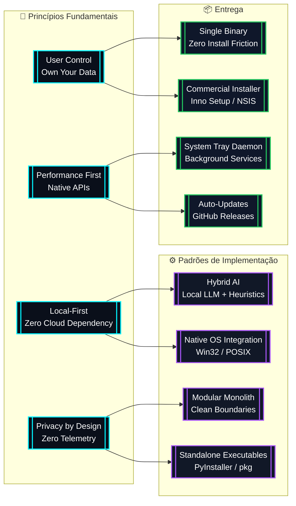

  

  
  
  
  

---

## 👨‍💻 Sobre Mim

**Desenvolvedor Full-Stack** especializado em **arquiteturas local-first**, **automação com IA** e **sistemas de alta performance** que rodam 100% no hardware do usuário — sem nuvem, sem telemetria, sem dependências externas.

> **Filosofia:** *Privacidade por design. Controle total. Zero vendor lock-in.*

| 🎯 **Foco Principal** | 🛠️ **Especialidades** | 🌍 **Abordagem** |
|----------------------|----------------------|------------------|
| Python • Node.js • TypeScript | FastAPI • Express • React • Vite | Local-First Architecture |
| Ollama • LLM Local • RAG | Win32 API • ctypes • psutil | Zero Telemetry |
| n8n • Webhooks • Automation | Docker • PyInstaller • Inno Setup | Open Source (MIT) |
| Computer Vision • OpenCV | FFmpeg • D3.js • Socket.io | Performance-First |

---

## 📊 Estatísticas do GitHub

  
  

  

---

## 🚀 Projetos em Destaque

Quatro ferramentas **production-ready** que resolvem problemas reais com arquitetura local-first:

### 🎬 [ClipRush Studio Pro](https://github.com/lcszero44-cell/ClipRush-Studio-Pro)
**Estúdio Local de Edição Viral com IA** — Transforma gameplays brutas (PS4/PS5/PC) em **Shorts 9:16 virais** e **Gameplays 16:9 editadas** para YouTube. Motor multimodal híbrido: Áudio RMS + OpenCV Optical Flow + Qwen 3.5 9B Vision (Ollama). **10 mecânicas de retenção viral** integradas no render. Piloto Automático Diário publica 1 Short/dia via YouTube OAuth2.

| Stack | Destaques |
|-------|-----------|
| `Python 3.12` `FastAPI` `OpenCV` `Ollama` `FFmpeg` `faster-whisper` `Playwright` | 100% Offline • Perfis PS4/PS5 calibrados • Kit Viral Auto (Título, Hook, Hashtags, Thumb) • Botão "Refazer" via IA sem re-render • Painel Raio-X de Erros com diagnóstico para IA |

  
  

---

### 💾 [AeroDisk Radar](https://github.com/lcszero44-cell/AeroDisk-Radar)
**Otimizador Windows Avançado com IA Local** — RAM Trim nativo (`EmptyWorkingSet`), Storage Radar ultra-rápido (multi-threaded `os.scandir`), **Traffic-Light Advisor** (Verde/Amarelo/Vermelho), Migração SSD C:→HDD D: com **Junctions Atômicas**, Diagnóstico Ollama (Auditor de Bolha, Duplicatas Gigantes BLAKE2b, Raio-X de Lentidão), Turbo Mode, RAM Auto-Pilot (85% threshold), Agendamento Semanal via Task Scheduler.

| Stack | Destaques |
|-------|-----------|
| `Python 3.10+` `FastAPI` `Ollama` `Win32 API` `psutil` `pywebview` `pystray` `D3.js v7` `Inno Setup` | 100% Local • EmptyWorkingSet nativo sem fechar apps • Junctions atômicas + Restore Point • BLAKE2b head+tail 64KB para duplicatas >500MB • Escudos permanentes (Ollama, Docker, VS Code, Navegadores, Windows Core) • Executável standalone ~27MB |

  
  

---

### 📱 [NexusZap Pro Local](https://github.com/lcszero44-cell/nexuszap-pro-local)
**Gateway WhatsApp Web Local** — Multi-instância com painel React, API REST, Webhooks **HMAC-SHA256** para n8n com retentativa exponencial (10 tentativas) e Dead Letter Queue. Socket.io tempo real para QR, status, mensagens. Bind `127.0.0.1:3333`, Token Bearer 64-char, Validação de origem. Baileys (WhiskeySockets) para protocolo WhatsApp Web.

| Stack | Destaques |
|-------|-----------|
| `Node.js 20+` `Express` `Socket.io` `Baileys` `React 18` `Vite 5` `Tailwind 3` `HMAC-SHA256` | 100% Local • Multi-sessão isolada (auth_info/<id>/) • Webhook assinado para n8n • Retentativa backoff exponencial + DLQ • QR Code no painel • Limite mídia 16MB • Scripts Windows `.bat` + Linux/macOS |

  
  

---

### 🏦 [Sistema Bancário Python](https://github.com/lcszero44-cell/sistema-bancario-python)
**Core Banking System com Clean Architecture** — Motor financeiro Decimal (`ROUND_HALF_UP`), **Ledger imutável** com protocolo UUID4 (8-char), compliance bancário completo (3 saques/dia, R$ 500/saque, saldo estrito, reset automático à meia-noite), CLI resiliente box-drawing, suíte unittest 100% nativa. **Zero dependências externas**.

| Stack | Destaques |
|-------|-----------|
| `Python 3.10+` `decimal.Decimal` `dataclasses` `unittest` `uuid` `re` | Clean Architecture (Domain/UI) • Decimal Financial Standard • Immutable Ledger Audit Trail • Banking Compliance Engine • Zero External Dependencies • 100% Test Coverage |

  
  

---

## 🏷️ Stack Tecnológica

  <!-- Core Languages -->
  
    
  <!-- Backend & APIs -->
  
  
  
    
  <!-- Frontend -->
  
    
  <!-- AI & Data -->
  
  
  
    
  <!-- Infrastructure & Tools -->
  
  
  
  
    
  <!-- Platform Specific -->
  
  
  

---

## 🏗️ Padrões Arquiteturais que Aplico

---

## 📈 Métricas de Qualidade (Auto-Impostas)

| Critério | Padrão | Como Garanto |
|----------|--------|--------------|
| **Cobertura de Erros** | 100% crítico | Painel Raio-X estruturado + "Copiar para IA" |
| **Privacidade** | Zero telemetria | Bind localhost, sem analytics, sem CDN |
| **Performance** | <100ms UI response | Multi-threading, cache inteligente, native APIs |
| **Distribuição** | Single binary | PyInstaller `--onefile` / `pkg` |
| **Instalação** | 1-clique | Scripts `.bat` + Inno Setup installers |
| **Documentação** | Visual-first | Banner 3D SVG + Mermaid + Tabelas + Collapsible |

---

## 🎓 Formação & Certificações

- **Engenharia de Software** — Foco em sistemas distribuídos e alta performance
- **Especializações:** Computer Vision (OpenCV), LLM Local Deployment (Ollama), Windows Internals (Win32 API), Automation (n8n)

---

## 📫 Contato & Links

  
  
  

---

## 💡 Projetos em Andamento / Roadmap

- [ ] **ClipRush v4**: Suporte a TikTok API direta + Multi-GPU render
- [ ] **AeroDisk v4**: WSL2 disk management + ZFS integration
- [ ] **NexusZap v2**: WhatsApp Business API bridge + Multi-tenant
- [ ] **Framework Base**: CLI toolkit para apps local-first (template compartilhado)

---

  <strong>🔓 Todos os projetos são Open Source (MIT) — Use, estude, modifique, contribua.</strong>

  

---

  <em>Feito com 💚 e muito ☕ — Local-First, Always.</em>

  <strong>lcszero44-cell</strong> — Código que respeita sua privacidade. Arquitetura que escala no seu hardware.

